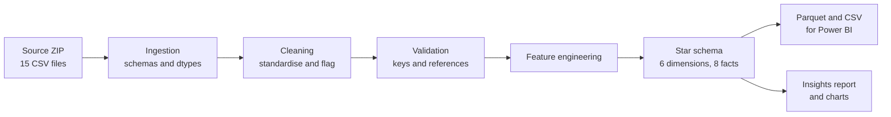
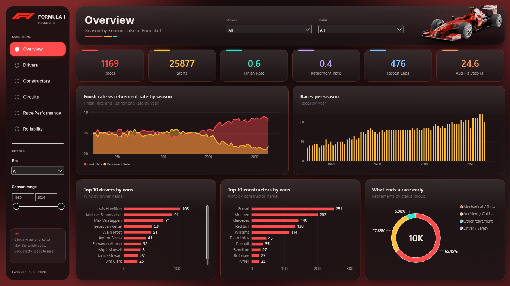
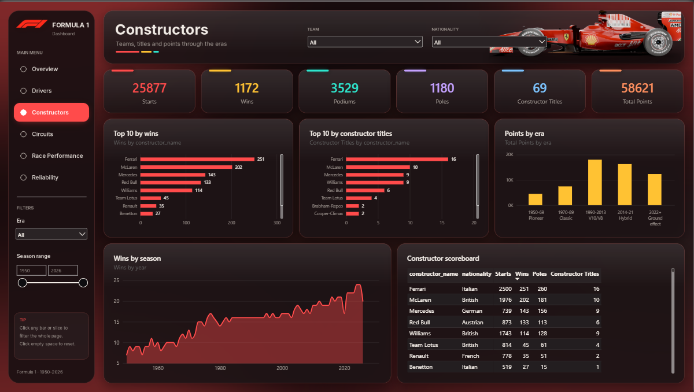
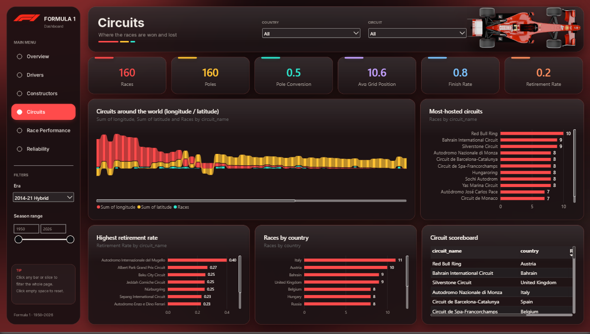
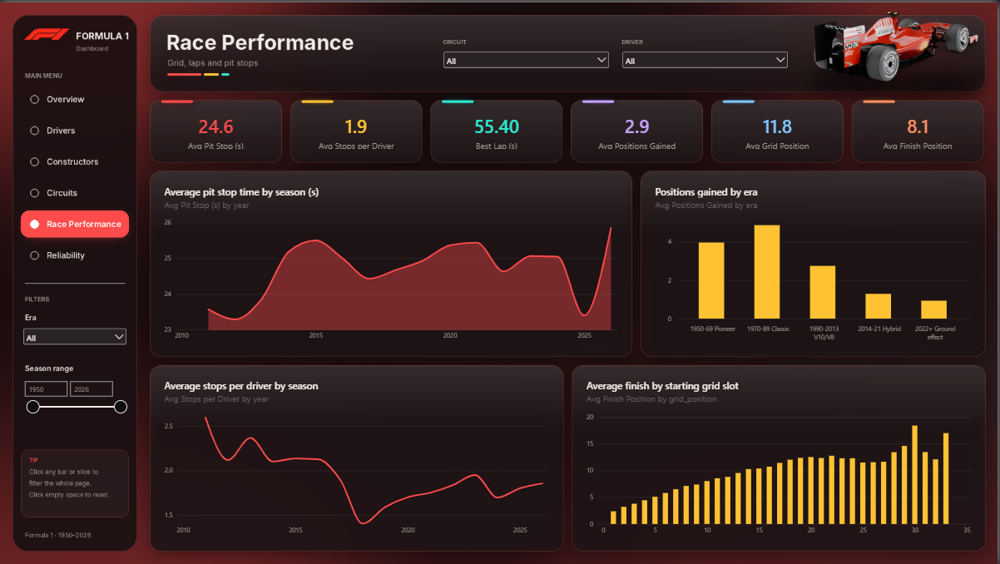
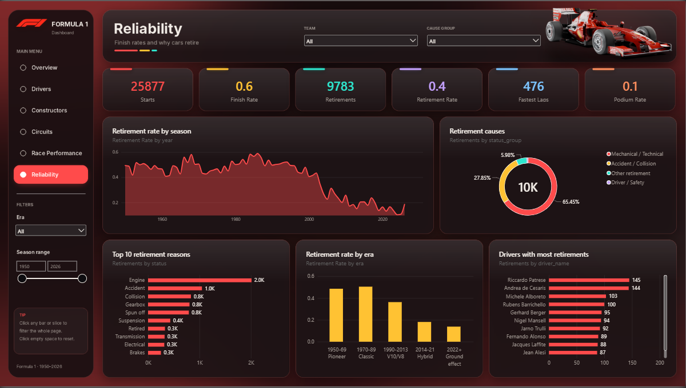
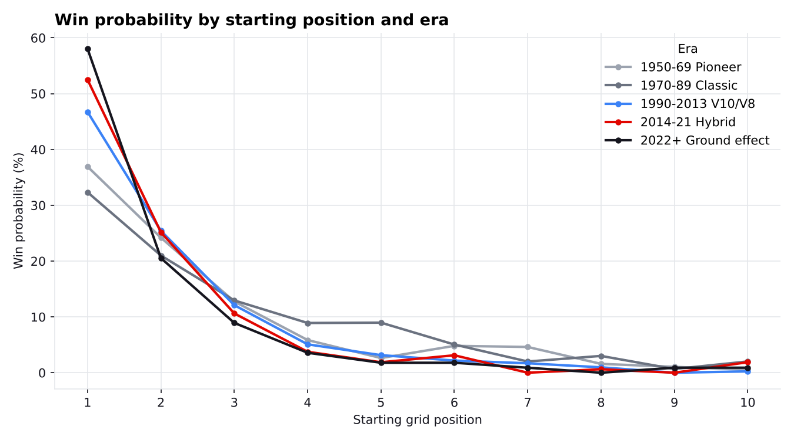

# Formula 1 Analytics

An end-to-end analytics pipeline for 75 years of Formula 1 data. It turns 15 raw CSV files into a validated, analysis-ready Power BI star schema and an automatically generated insights report.

## Highlights

- **Clean, validated ETL** with explicit schemas, typed columns and automated primary-key and foreign-key checks.
- **Memory-efficient ingestion**: the largest table (639k laps) loads in about half the default memory.
- **Feature engineering** for race analysis: positions gained, retirement classification, race completion, qualifying outcome and lap and pit stop statistics.
- **Power BI-ready star schema** with 6 dimensions and 8 fact tables, exported as Parquet and CSV.
- **Insights report** with 8 charts, generated from the warehouse on every run.
- **54 automated tests**, including an end-to-end run on the full dataset, linted with Ruff and verified on pandas 2 and pandas 3.

## Pipeline



## Quick start

```bash
pip install -e ".[dev]"
f1-analytics run --source path/to/archive.zip
```

| Command | Description |
| --- | --- |
| `f1-analytics build --source <zip or folder> [--format parquet\|csv\|both]` | Clean the data and write the star schema to `data/warehouse` |
| `f1-analytics report` | Generate `reports/insights.md` and charts from an existing Parquet warehouse |
| `f1-analytics run --source <zip or folder>` | Build the warehouse, then the report |

Use `--root <directory>` to write outputs somewhere other than the current directory.

### Google Colab

```python
!unzip -q f1-analytics.zip -d /content
!pip install -q /content/f1-analytics
!f1-analytics --root /content/f1-analytics run --source /content/archive.zip
```

Upload `f1-analytics.zip` and the data archive to `/content` first. Outputs are written under `/content/f1-analytics`.

## Outputs

| Path | Content |
| --- | --- |
| `data/warehouse/parquet` | 14 typed Parquet tables |
| `data/warehouse/csv` | The same tables as CSV |
| `reports/insights.md` | Findings, recent champions and charts |
| `reports/figures` | Chart images |

## Power BI dashboard

A six-page interactive report (Overview, Drivers, Constructors, Circuits, Race Performance, Reliability) built on the star schema.



| | |
| --- | --- |
|  |  |
|  |  |
|  | |

## Selected findings



- Starting on pole converts to a win 43.3% of the time overall, and from 58.0% in the 2022+ era down to 32.3% in the 1970-89 era.
- The share of starters who finished a race rose from 51.3% in the first ten seasons to 84.0% in the latest ten.
- On sprint weekends, drivers change fewer positions in sprints (2.24) than in the Grand Prix (2.96).

The full list is in [`reports/insights.md`](reports/insights.md).

## Documentation

- [Data model](docs/data_model.md): star schema, grain of every table, derived columns, data quality rules and coverage.
- [Power BI guide](docs/power_bi_guide.md): relationships, model settings, 24 DAX measures and the dashboard layout.

## Project structure

```
f1-analytics/
├── src/f1_analytics/
│   ├── ingestion.py     Source discovery, schema enforcement, typed loading
│   ├── schema.py        Table schemas, primary keys and references
│   ├── cleaning.py      Per-table cleaning and standardisation
│   ├── validation.py    Key and referential integrity checks
│   ├── features.py      Fact tables and derived metrics
│   ├── warehouse.py     Dimensions, star schema and export
│   ├── insights.py      Analyses and report generation
│   ├── plotting.py      Chart styling and figures
│   ├── pipeline.py      Orchestration
│   └── cli.py           Command line interface
├── tests/               Unit and integration tests
├── notebooks/           Colab notebooks: cleaning, features, Power BI export
├── dashboard/           Power BI report (.pbix), theme and backgrounds
├── docs/                Data model and Power BI guide
├── reports/             Generated insights and charts
└── data/                Raw input and warehouse output (git-ignored)
```

## Development

```bash
make install   # install with development dependencies
make test      # run the test suite
make lint      # run Ruff checks
make run SOURCE=path/to/archive.zip
```

Set `F1_ARCHIVE` to the source ZIP to include the full end-to-end test in `make test`.

## Data

The source is an archive of 15 CSV files covering Formula 1 seasons from 1950 to 2026 (circuits, constructors, drivers, races, results, qualifying, lap times, pit stops, standings, sprint results and practice sessions). The data is not included in this repository.

## License

MIT
