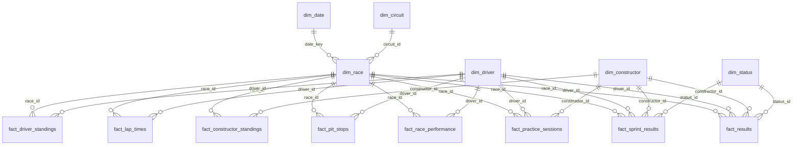

# Data Model

The warehouse is a star schema built for Power BI. Dimensions describe who, where and when; fact tables hold one row per measurable event. `dim_race` is the central dimension and has two outriggers (`dim_date`, `dim_circuit`).

## Dimensions

| Table | Grain | Columns |
| --- | --- | --- |
| `dim_date` | Calendar day, first to last race date | `date_key`, `date`, `year`, `quarter`, `month`, `month_name`, `day`, `day_of_week`, `day_name`, `is_weekend` |
| `dim_race` | Grand Prix | `race_id`, `race_label`, `race_name`, `year`, `round`, `rounds_in_season`, `date_key`, `date`, `circuit_id`, `era`, `decade`, `race_laps`, `has_sprint`, `has_qualifying_data`, `has_lap_data`, `has_pit_data` |
| `dim_circuit` | Circuit | `circuit_id`, `circuit_ref`, `circuit_name`, `location`, `country`, `latitude`, `longitude`, `altitude_m` |
| `dim_driver` | Driver | `driver_id`, `driver_ref`, `driver_name`, `driver_code`, `driver_number`, `birth_date`, `nationality` |
| `dim_constructor` | Constructor | `constructor_id`, `constructor_ref`, `constructor_name`, `nationality` |
| `dim_status` | Finishing status | `status_id`, `status`, `status_group`, `is_finished` |

## Facts

| Table | Grain | Key |
| --- | --- | --- |
| `fact_results` | One driver in one Grand Prix | `result_id` |
| `fact_sprint_results` | One driver in one sprint | `result_id` |
| `fact_race_performance` | One driver in one Grand Prix (lap and pit stop statistics) | `race_id`, `driver_id` |
| `fact_pit_stops` | One pit stop | `race_id`, `driver_id`, `stop` |
| `fact_lap_times` | One lap | `race_id`, `driver_id`, `lap` |
| `fact_practice_sessions` | One driver in one practice session | `race_id`, `driver_id`, `session` |
| `fact_driver_standings` | Driver championship position after a round | `race_id`, `driver_id` |
| `fact_constructor_standings` | Constructor championship position after a round | `race_id`, `constructor_id` |

### `fact_results` derived columns

| Column | Definition |
| --- | --- |
| `grid_position` | Starting slot; empty when the car started from the pit lane |
| `starts_from_pit_lane` | True when the recorded grid slot was 0 |
| `finish_position` | Classified finishing position; empty when not classified |
| `position_order` | Final order including non-classified entries; always populated |
| `positions_gained` | `grid_position - position_order`; positive means places gained. Only for classified cars with a real grid slot |
| `laps_completed_pct` | Laps completed divided by the longest distance in that race |
| `qualifying_position`, `best_q_ms`, `reached_q3` | Qualifying outcome, available from 1994 |
| `is_finished` | Status is Finished or a lapped classification |
| `is_dnf` | Retired for a mechanical, collision, driver-related or other reason |
| `is_disqualified`, `is_dns` | Disqualified, or did not start / not classified |
| `is_win`, `is_podium`, `is_points_finish` | Result flags |
| `has_fastest_lap`, `started_on_pole` | Fastest-lap rank 1, grid position 1 |
| `is_shared_drive` | The driver has more than one result in the same race (1950-1964) |
| `age_at_race` | Driver age in years on race day |

### `fact_race_performance` derived columns

| Column | Definition |
| --- | --- |
| `best_lap_ms`, `avg_lap_ms`, `median_lap_ms`, `lap_std_ms`, `clean_laps` | Lap statistics excluding outlier laps |
| `laps_recorded`, `outlier_laps`, `first_lap_position` | Lap coverage and the running order at the end of lap 1 |
| `pit_stops`, `total_pit_s`, `avg_pit_s`, `first_stop_lap` | Pit stop statistics excluding outlier stops; empty when the race has no pit stop data |
| `outlier_stops` | Stops flagged as outliers |
| `has_lap_data`, `has_pit_data` | Whether the driver has any lap or pit stop records |

## Data quality rules

| Rule | Treatment |
| --- | --- |
| Missing values (`\N`, `?`, blanks) | Read as null; never replaced with zero |
| Pit lane starts (`grid = 0`) | Moved to `starts_from_pit_lane`; `grid_position` left empty |
| Lap time above 2x the race median | Flagged `is_outlier_lap`, retained |
| Pit stop longer than 120 seconds | Flagged `is_outlier_stop`, retained |
| Missing driver code | Generated from the first three letters of the surname |
| Missing nationality | Set to `Unknown` |
| Country aliases (`UK`, `USA`, `UAE`, `Korea`) | Standardised to full country names |
| Drivers sharing a car (1950-1964) | Both keep their result; `is_shared_drive` is set |
| Referential integrity | Source and warehouse are validated; any orphan or duplicate key stops the build |

## Data coverage

| Area | First season |
| --- | --- |
| Race results, standings | 1950 |
| Constructor standings | 1958 |
| Qualifying | 1994 |
| Lap times | 1996 |
| Pit stops | 2011 |
| Sprint results | 2021 |
| Practice sessions | 2025 |
