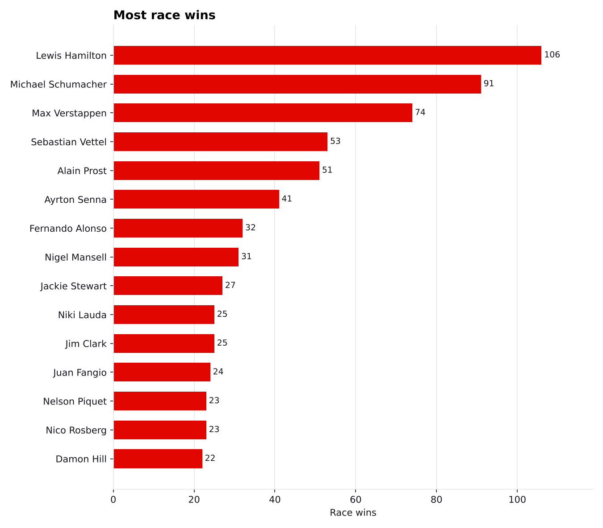
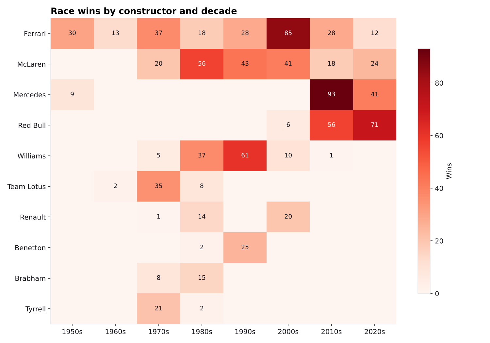
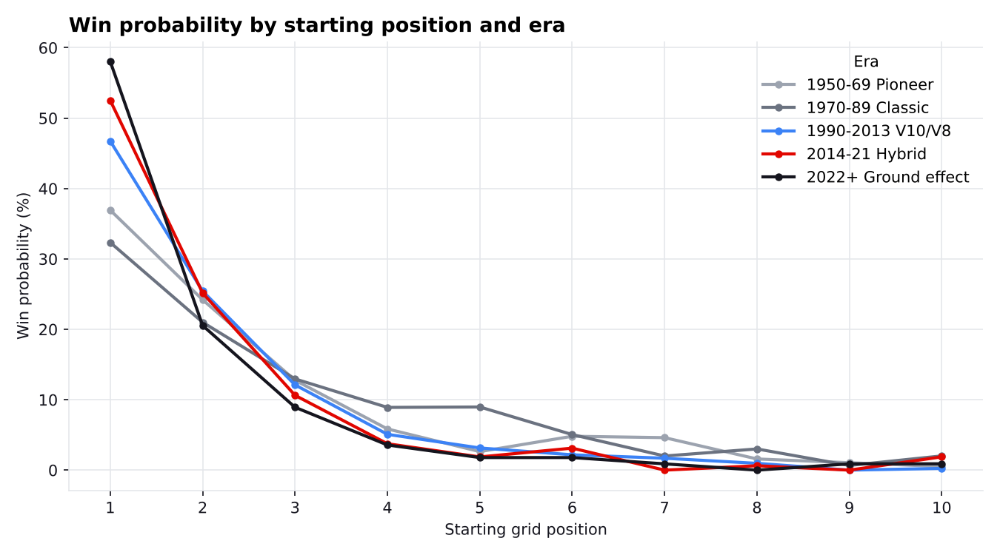
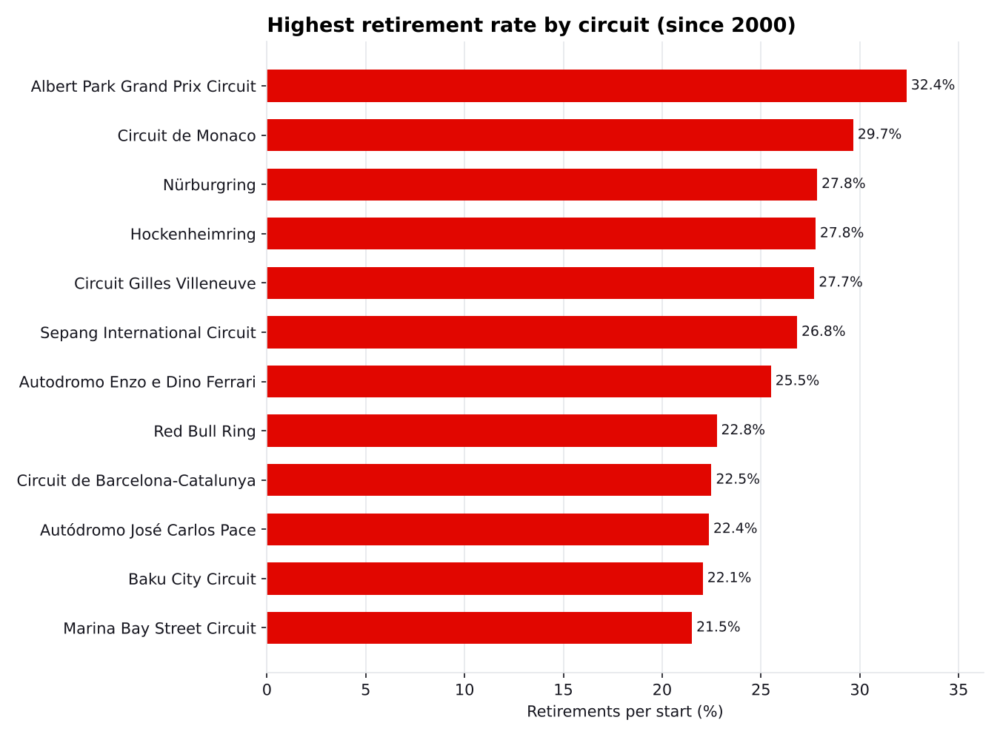
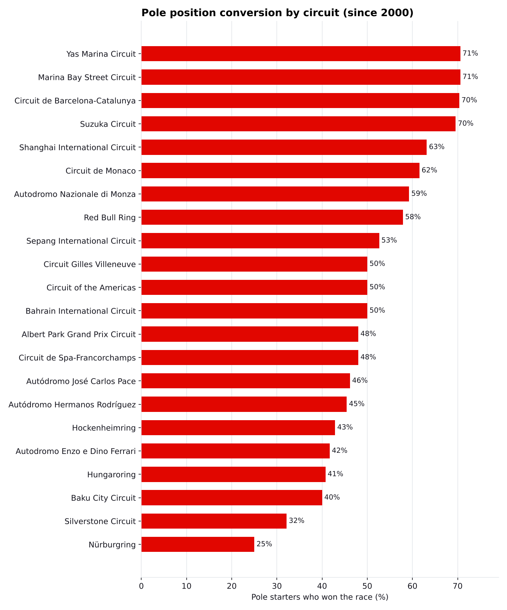
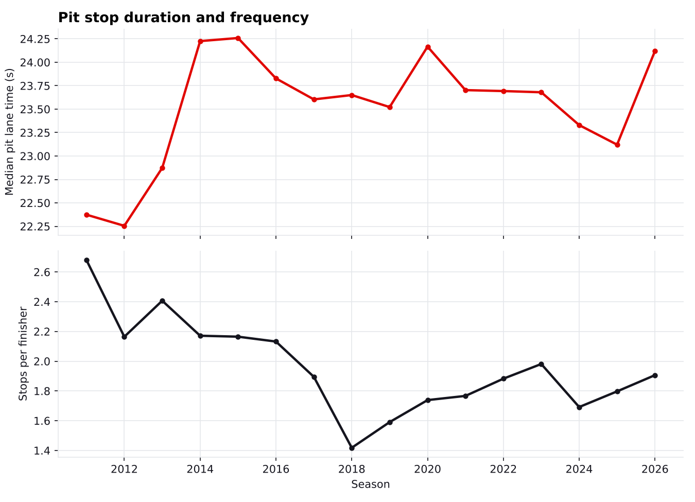
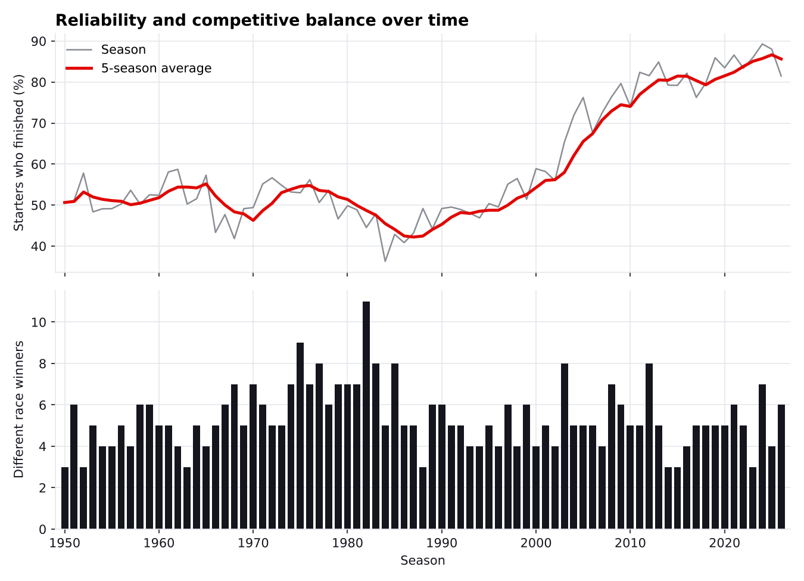
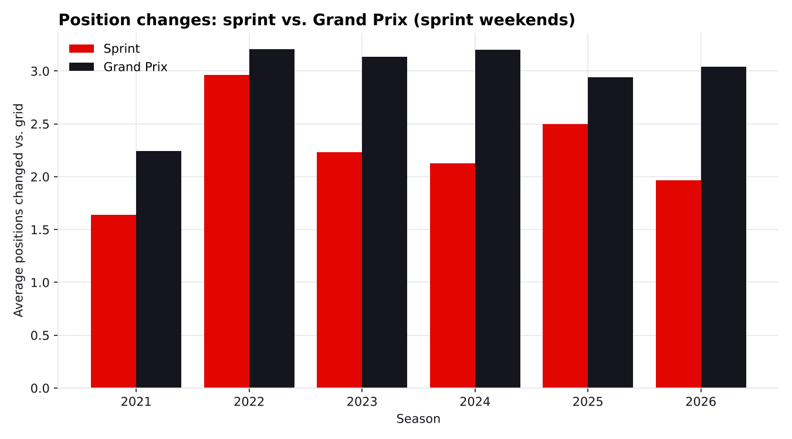

# Formula 1 Insights Report

The dataset covers 1950-2026: 1,169 races, 820 drivers, 205 constructors and 78 circuits, with 26,313 race results and 639,293 recorded laps.

## Key findings

- **Lewis Hamilton** leads all drivers with 106 wins and 209 podiums (26.5% win rate).
- **Ferrari** is the most successful constructor with 251 race wins.
- Starting on pole converts to a win 43.3% of the time overall; by era the rate ranges from 32.3% to 58.0%.
- The share of starters who finished rose from 51.3% in the first ten seasons to 84.0% in the latest ten.
- Since 2000, **Albert Park Grand Prix Circuit** has the highest retirement rate (32.4% of starts).
- Pole conversion since 2000 ranges from 25.0% at Nürburgring to 70.6% at Yas Marina Circuit.
- Median pit lane time moved from 22.4s in 2011 to 24.1s in 2026.
- On sprint weekends, drivers change 2.24 positions on average in sprints versus 2.96 in the Grand Prix.

## Recent champions

| Season | Driver champion | Wins | Points | Constructor champion |
| --- | --- | --- | --- | --- |
| 2017 | Lewis Hamilton | 9 | 363 | Mercedes |
| 2018 | Lewis Hamilton | 11 | 408 | Mercedes |
| 2019 | Lewis Hamilton | 11 | 413 | Mercedes |
| 2020 | Lewis Hamilton | 11 | 347 | Mercedes |
| 2021 | Max Verstappen | 10 | 395.5 | Mercedes |
| 2022 | Max Verstappen | 15 | 454 | Red Bull |
| 2023 | Max Verstappen | 19 | 575 | Red Bull |
| 2024 | Max Verstappen | 9 | 437 | McLaren |
| 2025 | Lando Norris | 7 | 423 | McLaren |
| 2026 | Andrea Kimi Antonelli | 9 | 390 | Mercedes |

## Driver leaders

## Constructor dominance by decade

## Starting position and winning

## Circuit retirement rates

## Pole conversion

## Pit stop trends

## Season trends

## Sprint races

## Method notes

- Retirement rate counts starters whose status is a mechanical failure, collision, driver-related stoppage or other retirement. Disqualifications and non-starters are excluded.
- Pit stop statistics start in 2011, the first season with pit stop data, and exclude stops longer than two minutes.
- Circuit rankings require at least 10 races since 2000.
- Wins are credited to each driver who shared a winning car in the 1950s.
